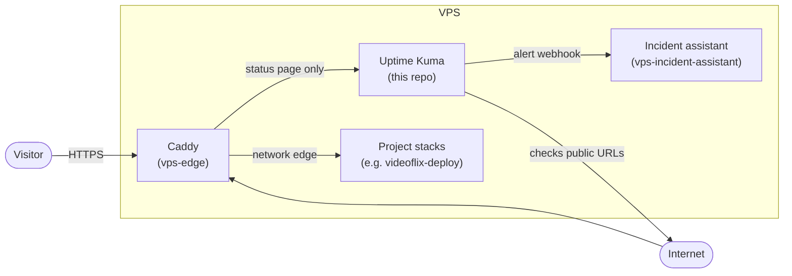

# vps-monitoring

Monitoring stack for all projects on the VPS: [Uptime Kuma](https://github.com/louislam/uptime-kuma) checks the public HTTPS addresses, sends alerts and serves the public status page at [status.philipp-klinger.com](https://status.philipp-klinger.com).

## Overview

- Uptime Kuma checks every public address from outside, the way a visitor does (DNS, certificate, proxy, app)
- Public status page at [status.philipp-klinger.com](https://status.philipp-klinger.com) with one page per project and neutral names only
- Alerts go to Telegram and to the [incident assistant](https://github.com/PhilippKlinger/vps-incident-assistant)
- Kuma has no route to the project containers and no Docker socket; the dashboard is not public

## Architecture

## Tech stack

- Uptime Kuma 2 (`slim-rootless`, pinned by digest) with SQLite
- Docker Compose, journald

## CI and security

- **Validate compose and workflows:** compose validation, actionlint
- **Start stack and check security properties:** health, dashboard bound to localhost, non-root, only the expected networks, no Docker socket
- **Scan pinned image (Trivy):** accepted findings live in `.trivyignore.yaml` with a reason and an expiry date
- **Security checks:** secret scan (gitleaks), workflow lint (zizmor), CodeQL for the workflows

All checks are required before a merge. Troubleshooting: [RUNBOOK.md](RUNBOOK.md).

## Related repositories

| Repository | Role |
|---|---|
| [vps-edge](https://github.com/PhilippKlinger/vps-edge) | Publishes the status page and owns the network `monitoring` |
| [vps-incident-assistant](https://github.com/PhilippKlinger/vps-incident-assistant) | Receives the alert webhook and uses RUNBOOK.md as runbook |
| [videoflix-deploy](https://github.com/PhilippKlinger/videoflix-deploy) | Videoflix stack, watched by two monitors |
| [v-server-setup](https://github.com/PhilippKlinger/v-server-setup) | How the server is set up and hardened |

## License

[MIT](LICENSE)
