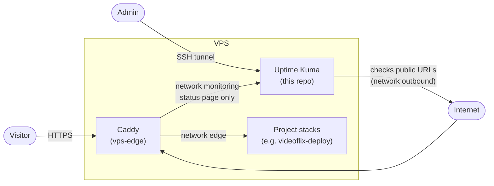

# vps-monitoring

[](https://github.com/PhilippKlinger/vps-monitoring/actions/workflows/ci.yml)
[](https://github.com/PhilippKlinger/vps-monitoring/actions/workflows/security.yml)
[](https://github.com/PhilippKlinger/vps-monitoring/actions/workflows/codeql.yml)
[](https://scorecard.dev/viewer/?uri=github.com/PhilippKlinger/vps-monitoring)

Monitoring stack for all projects on the VPS: [Uptime Kuma](https://github.com/louislam/uptime-kuma) checks the public HTTPS addresses, sends alerts and serves the public status page at [status.philipp-klinger.com](https://status.philipp-klinger.com).

## Architecture



- Kuma is not part of the network `edge`: it cannot reach any project container and checks every service the way a visitor does (DNS, TLS certificate, Caddy, app).
- The network `monitoring` belongs to [vps-edge](https://github.com/PhilippKlinger/vps-edge) and is internal. Caddy publishes only the status page, its API, badges and static files; everything else, including the dashboard and login, returns 404.
- The dashboard is bound to `127.0.0.1:3001` on the server and is only reachable through an SSH tunnel.

## Contents

- `compose.yaml`: Uptime Kuma 2 (`slim-rootless`, pinned by digest) with SQLite in the volume `kuma_data`, no Docker socket, dropped capabilities, resource limits, journald logging
- `.github/workflows/`: CI (compose validation, actionlint, smoke test of the running stack, Trivy scan of the pinned image), Security Checks (gitleaks, zizmor), CodeQL for the workflows, OpenSSF Scorecard
- `.github/dependabot.yml`: weekly updates for the image and the pinned actions, 14 days cooldown
- `.trivyignore.yaml`: accepted image vulnerabilities, each with a reason and an expiry date; after that date the CI fails again

## Configuration

| Setting | Where | Value |
|---|---|---|
| Database | `compose.yaml` (`UPTIME_KUMA_DB_TYPE`) | `sqlite`, skips the setup page |
| Monitors, status pages, notifications | Kuma dashboard, stored in `kuma_data` | see [Runbook](#runbook) |
| Telegram bot token for alerts | Kuma dashboard only | never in Git or `.env` |

The stack needs no `.env`.

## Usage on the server

Requires [vps-edge](https://github.com/PhilippKlinger/vps-edge) with the network `monitoring` (start or update vps-edge first).

```bash
sudo install -d -m 750 -o deploy -g deploy /srv/monitoring
# copy compose.yaml to /srv/monitoring, then:
cd /srv/monitoring
docker compose pull
docker compose up -d
docker compose ps            # uptime-kuma: healthy after about a minute
```

Open the dashboard from your own machine:

```bash
ssh -L 3001:127.0.0.1:3001 <user>@<host>
# then browse http://localhost:3001
```

Update: change the image in `compose.yaml` through a pull request (Dependabot), then `docker compose pull && docker compose up -d`. The volume keeps all data.

## Runbook

### First setup

1. Open the dashboard through the tunnel and create the admin account (long password), then enable 2FA under *Settings → Security*.
2. *Settings → General*: time zone `Europe/Berlin`, *Primary Base URL* `https://status.philipp-klinger.com`.
3. *Settings → Reverse Proxy*: *Trust Proxy* `Yes` (Caddy sets `X-Forwarded-For`).
4. *Settings → Notifications*: Telegram notification with a dedicated bot (token and chat ID from the password manager), *Default enabled* and *Apply on all existing monitors*, then *Test*.

### Monitors

All monitors: type HTTP(s), interval 60 s, retries 3, retry interval 60 s, *Certificate Expiry Notification* on (14 days), accepted status codes 200–299.

| Name (public) | URL | Status page |
|---|---|---|
| Videoflix · Web-App | `https://videoflix.philipp-klinger.com/` | `videoflix` |
| Videoflix · API | `https://videoflix.philipp-klinger.com/api/health/` | `videoflix` |
| Portfolio | `https://philipp-klinger.com/` | `portfolio` |
| Neuro Check-in · Web | `https://neurocheckin.de/` | `neuro-check-in` |
| Blog | `https://philippklinger.github.io/my-dso-blog/` | none (internal) |

Next: Conduit (web app and API, status page `conduit`) once it runs on the VPS.

### Status pages

| Slug | Title | Monitors |
|---|---|---|
| `videoflix` | Videoflix | Videoflix · Web-App, Videoflix · API |
| `portfolio` | Portfolio | Portfolio |
| `neuro-check-in` | Neuro Check-in | Neuro Check-in · Web |

Leave *Show URL* off, so the page shows neutral names only (no hosts, IPs or ports). `https://status.philipp-klinger.com/` redirects to `/status/videoflix`.

### Rebuild

Without a backup of `kuma_data` (planned together with the project backups), a rebuild means: start the stack, repeat *First setup*, *Monitors* and *Status pages* above. The uptime history starts again from zero.

### Check after a change

```bash
curl -sI https://status.philipp-klinger.com/status/videoflix | head -1               # 200
curl -s  https://status.philipp-klinger.com/api/status-page/heartbeat/videoflix | head -c 200
curl -sI https://status.philipp-klinger.com/dashboard | head -1                      # 404
```

## Limits

- Kuma runs on the same VPS it watches: if the whole server is down, no alert goes out. An external check is planned for later.
- The public heartbeat API of Kuma 2 returns the 24-hour uptime only; the 30-day value is available as a badge.
